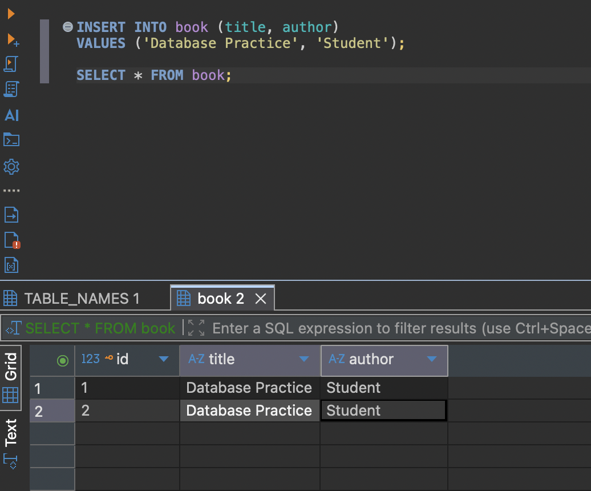
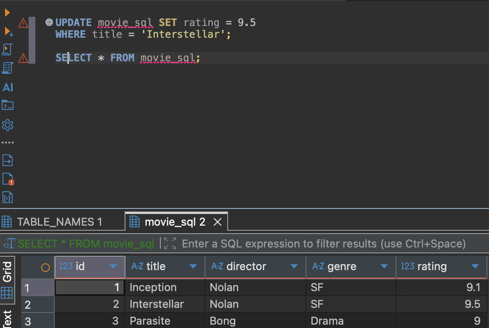
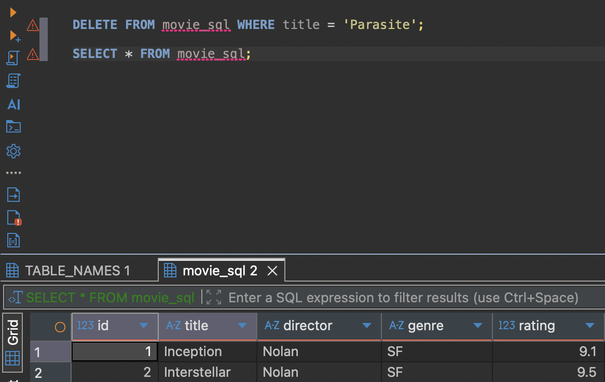
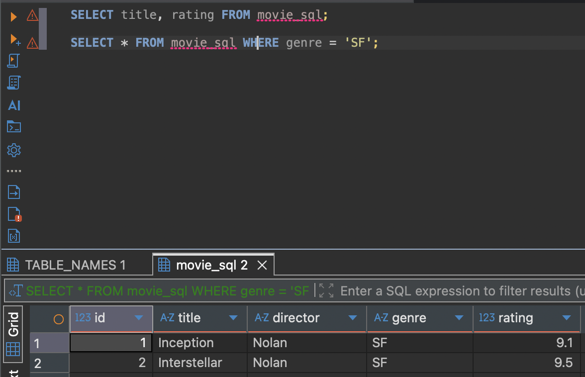

# ① 프로젝트 소개

## 주제 및 주요 기능

- 여행 계획을 등록·조회·수정·삭제하는 REST API다.
- 9주차 CRUD에 Query Method 검색·정렬, Dirty Checking, Auditing을 추가했다.
- 검색 4종: 국가, 국가와 여행일수, 여행지와 예산 내림차순, 예산 초과와 출발일 오름차순
- 필수 값 누락은 400, 없는 id는 404로 응답한다.

## Entity 필드 구조

- 테이블은 travels, Entity는 Travel 하나다.
- id, destination, country, city, departureDate, durationDays, budget, createdAt, updatedAt
- createdAt과 updatedAt은 Auditing으로 자동 기록한다.

## 프로젝트 구조 및 개발환경

- domain: controller, service, repository, model, dto
- global: exception
- Java 17, Spring Boot 3.5.6, Spring Data JPA, MariaDB, Docker, Render

## GitHub Repository URL

- Organization: https://github.com/2026-2-WebService/assign10-c01-22300404
- 개인 저장소: https://github.com/Evvvaaaaan/week10_webService

## Render Deployment URL

- https://week10-webservice-184j.onrender.com

# ② Database SQL Practice

## 기존 Table 조회 및 데이터 추가 결과

- book 테이블을 조회하고 INSERT를 두 번 실행해 2행을 추가했다.

## 새 Table 생성 SQL

- CREATE TABLE movie_sql (id BIGINT AUTO_INCREMENT PRIMARY KEY, title VARCHAR(100) NOT NULL, director VARCHAR(100), genre VARCHAR(50), rating DOUBLE);

## INSERT / UPDATE / DELETE / SELECT SQL과 실행 결과

- INSERT로 Inception, Interstellar, Parasite 3행을 추가했다.
- UPDATE로 Interstellar의 rating을 9.3에서 9.5로 바꿨다.
- DELETE로 Parasite를 지워 2행만 남았다.
- SELECT로 title, rating 컬럼 조회와 genre = 'SF' 조건 조회를 실행했다.

## DBeaver 실행 화면 또는 결과

- 위 화면은 모두 DBeaver에서 실행한 결과다.
- UPDATE와 DELETE 후 SELECT로 바뀐 데이터를 확인했다.

# ③ Spring Data JPA 구현

## Entity 및 JpaRepository 설명

- Travel에 @Entity, @Table(name = "travels")를 붙여 테이블과 매핑했다.
- id는 @Id와 @GeneratedValue(IDENTITY)로 AUTO_INCREMENT를 사용한다.
- TravelRepository는 JpaRepository<Travel, Long>을 상속해 기본 CRUD를 구현 없이 쓴다.
- Query Method 4개를 메서드 이름만으로 선언했다.

## 사용한 Annotation의 역할

- @Entity, @Table, @Id, @GeneratedValue: Entity, 테이블, 기본키, 키 생성 방식
- @Column: 컬럼 길이, NULL 여부, 정밀도
- @EntityListeners, @CreatedDate, @LastModifiedDate, @EnableJpaAuditing: 생성·수정 시각 자동 기록
- @Transactional: DB 작업을 하나의 트랜잭션으로 묶음
- @RestController, @RequestMapping, @RequestBody, @PathVariable, @RequestParam: API 연결과 값 바인딩
- @RestControllerAdvice, @ExceptionHandler: 예외를 JSON으로 응답

## REST API Endpoint 목록 및 요청·응답 JSON

- POST /api/travels, GET /api/travels, GET·PUT·DELETE /api/travels/{id}
- GET /api/travels?country=, ?country=&minDays=&maxDays=, ?keyword=, ?minBudget=
- 요청: {"destination":"Deploy Check","country":"South Korea","city":"Seoul","departureDate":"2027-05-01","durationDays":3,"budget":400000}
- 응답: {"id":8,"destination":"Deploy Check","createdAt":"2026-11-09T07:12:41.183223","updatedAt":"2026-11-09T07:12:41.183223"}
- 오류: 400 INVALID_REQUEST, 404 ID_NOT_FOUND

## JPA Entity와 MariaDB Table 비교

- 카멜케이스 필드는 스네이크케이스 컬럼이 된다.
- departureDate는 departure_date, durationDays는 duration_days, createdAt은 created_at이다.

# ④ JPA와 SQL 비교

## save(), findAll(), findById(), deleteById() 사용 결과

- save: 등록은 INSERT, 수정은 UPDATE
- findAll: 전체 SELECT
- findById: id 단건 SELECT, Optional 반환
- deleteById: 삭제, 없는 id는 findById로 먼저 확인해 404

## 실제 Hibernate SQL 확인

- INSERT: insert into travels (budget, city, country, created_at, departure_date, destination, duration_days, updated_at, id) values (?, ?, ?, ?, ?, ?, ?, ?, default)
- SELECT: select ... from travels where id=?
- UPDATE: update travels set budget=?, city=?, country=?, departure_date=?, destination=?, duration_days=?, updated_at=? where id=?
- DELETE: delete from travels where id=?
- UPDATE에 created_at이 빠지는 것은 @Column(updatable = false) 때문이다.

## SQL을 직접 작성하는 방식과 JPA 방식의 차이

- SQL 직접 작성은 테이블과 쿼리를 직접 관리해 실행을 정확히 제어한다.
- JPA는 Entity와 메서드로 처리하고 SQL은 Hibernate가 만들며, 실행 SQL은 로그로 확인해야 한다.

# ⑤ 배포 및 환경 설정

## IntelliJ 및 Render 환경변수 설정 방법

- DB_URL, DB_USERNAME, DB_PASSWORD 세 개만 등록한다.
- IntelliJ는 Run Configuration, Render는 Environment 탭에 넣는다.
- PORT는 Render가 자동으로 넣는다.

## Render 배포 과정

- GitHub 저장소를 Docker Runtime으로 연결하고 Environment에 DB 값을 넣었다.
- Health Check Path는 /api/travels다.

## 배포 URL의 CRUD 테스트 결과

- POST 201, GET 200, PUT 200, DELETE 204, 삭제 후 GET 404
- 검색 4종 모두 200, 필수 값 누락 POST는 400
- 테스트 데이터는 삭제해 기존 데이터만 남겼다.

## MariaDB 데이터 저장 확인

- 등록 직후 created_at과 updated_at이 같은 시각으로 저장된다.
- 수정 후 created_at은 그대로이고 updated_at만 바뀐다.

## 발생한 문제와 해결 방법

- DB_URL이 비어 Dialect 오류가 났다. ${DB_URL:기본값} 형식과 Docker MariaDB로 해결했다.
- 검색 대소문자 문제는 ContainingIgnoreCase로 해결했다.

# ⑥ Weekly Report

## Key Learning

- Query Method는 메서드 이름 규칙만으로 SQL이 만들어진다.
- Dirty Checking은 @Transactional 안에서 스냅샷과 현재 값을 비교해 UPDATE 한다.
- Auditing은 @EnableJpaAuditing, @EntityListeners, @CreatedDate, @LastModifiedDate가 함께 있어야 동작한다.

## Problem & Solution

- 검색 API가 전체 조회와 경로가 겹쳤다. @GetMapping(params = ...)로 파라미터별 매핑을 나눠 해결했다.
- H2 테스트에서 대소문자로 결과가 달라져 ContainingIgnoreCase를 적용했다.

## Code Review

- TravelService.update()는 findById로 Entity를 조회하고 필드만 변경한다.
- repository.save()는 호출하지 않는다.
- @Transactional이 커밋 시점에 변경을 감지해 UPDATE 한다.
- 그래서 응답의 updatedAt은 커밋 전 값이라 조회 결과보다 이전일 수 있다.

## AI Usage

- CodeBuddy Code를 개념 설명과 오류 해결에 사용했다.
- AI 제안 중 대소문자 처리와 Auditing NULL 허용은 직접 수정했다.
- 사용률은 40% 정도로 본다.

## Reflection

- Query Method가 길어질 때 @Query나 Querydsl로 분리하는 방법을 공부하고 싶다.
