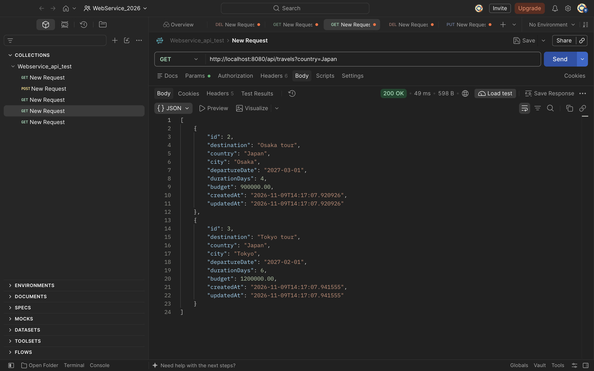
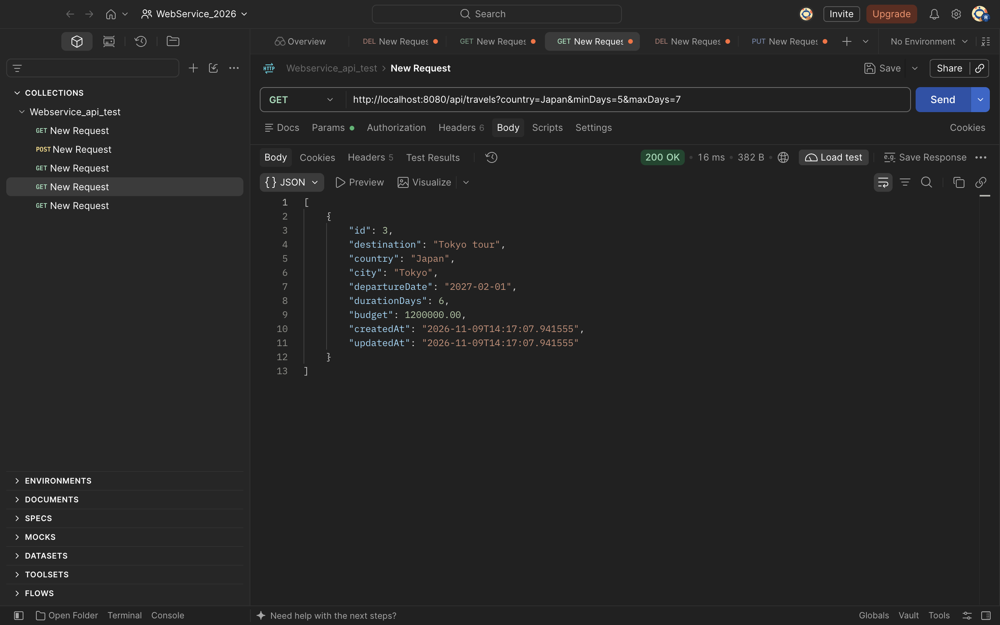
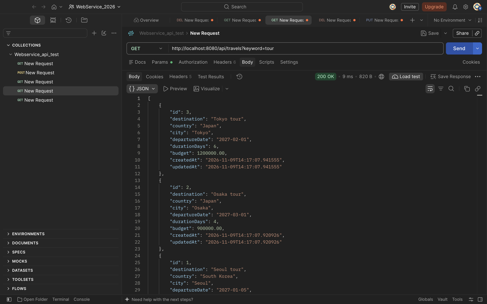
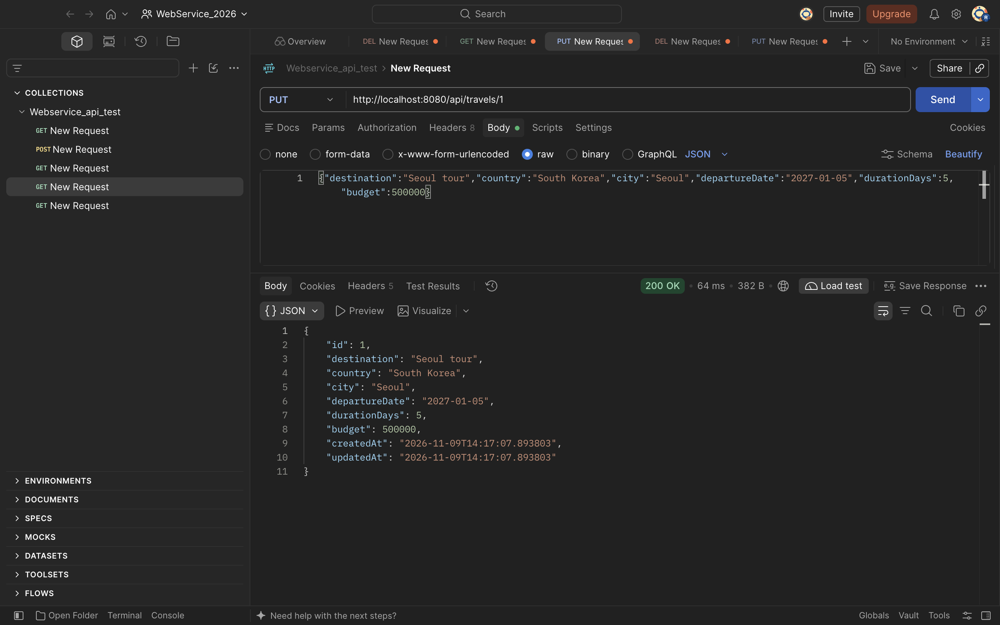
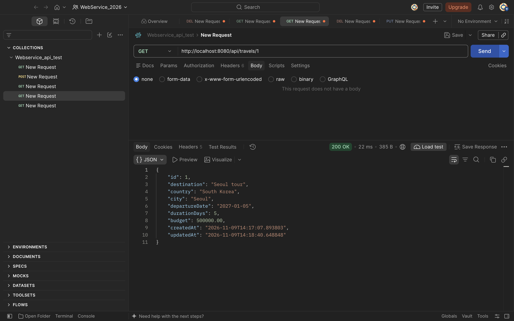
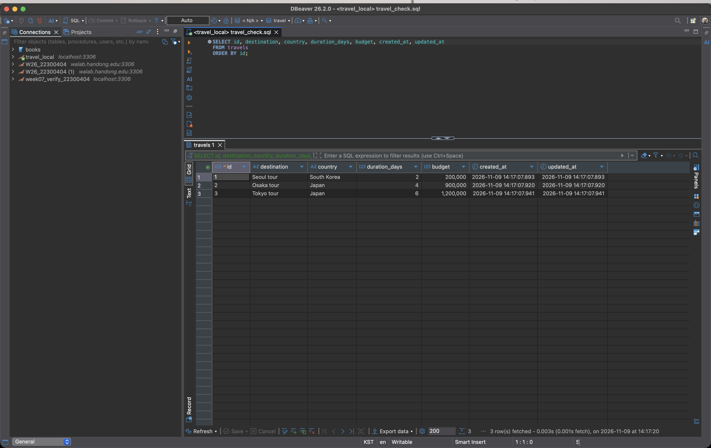
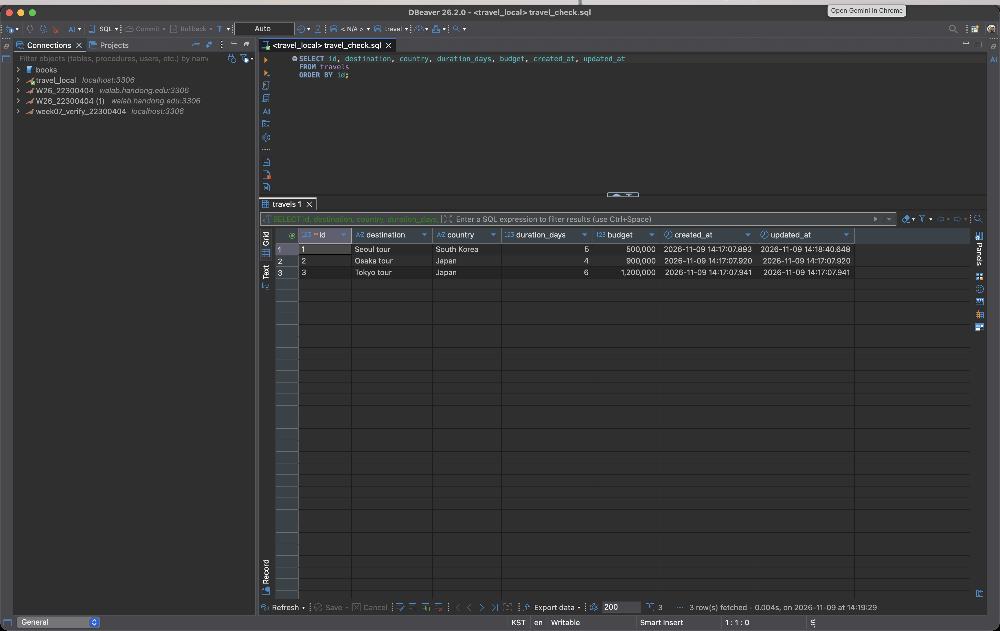

# 여행 계획 REST API

- GitHub: https://github.com/2026-2-WebService/assign10-c01-22300404
- 개인 저장소: https://github.com/Evvvaaaaan/week10_webService
- Render: (배포 후 입력)

# 1. 프로젝트 소개

- 여행 계획을 등록·조회·수정·삭제하고 MariaDB에 저장하는 REST API다.
- 9주차 CRUD 프로젝트에 Query Method 검색·정렬, Dirty Checking 수정, Auditing 시각 자동 기록을 추가했다.
- 사용 기술은 Java 17, Spring Boot 3.5.6, Spring Data JPA, MariaDB다.
- Entity는 Travel 하나이고 테이블은 travels다.

## API 목록

- POST /api/travels : 등록
- GET /api/travels : 전체 조회
- GET /api/travels/{id} : 단건 조회
- PUT /api/travels/{id} : 수정
- DELETE /api/travels/{id} : 삭제
- GET /api/travels?country=Japan : 국가 검색
- GET /api/travels?country=Japan&minDays=5&maxDays=7 : 국가와 여행일수 범위 검색
- GET /api/travels?keyword=tour : 여행지 부분 검색, 예산 내림차순
- GET /api/travels?minBudget=500000 : 예산 초과 검색, 출발일 오름차순

## 실행 방법

- Docker로 MariaDB를 띄운다. 데이터베이스 이름은 travel이다.
- 프로젝트 루트에서 ./gradlew bootRun 으로 실행한다.
- 접속 정보는 환경변수 DB_URL, DB_USERNAME, DB_PASSWORD에서 읽고, 없으면 로컬 기본값을 쓴다.
- Render에서는 환경변수로 운영 DB 정보를 넣는다.

# 2. 주요 구현 내용 및 결과

## 2-1. Query Method 검색·정렬

- Repository에 메서드 이름만 선언했고 구현 클래스와 SQL은 작성하지 않았다.
- findByCountry : WHERE country = ?
- findByCountryAndDurationDaysBetween : WHERE country = ? AND duration_days BETWEEN ? AND ?
- findByDestinationContainingIgnoreCaseOrderByBudgetDesc : WHERE UPPER(destination) LIKE UPPER(?) ORDER BY budget DESC
- findByBudgetGreaterThanOrderByDepartureDateAsc : WHERE budget > ? ORDER BY departure_date ASC
- 검색 API는 GET /api/travels?파라미터 형태로 만들었고, 같은 경로에서 충돌하지 않도록 @GetMapping(params = ...)로 구분했다.

### 실행 결과

- 등록한 데이터는 Seoul tour(2일, 200000), Osaka tour(4일, 900000), Tokyo tour(6일, 1200000) 세 건이다.
- country=Japan 로 검색하면 Osaka tour, Tokyo tour 2건이 나온다.

- country=Japan&minDays=5&maxDays=7 로 검색하면 Tokyo tour 1건만 나온다.

- keyword=tour 로 검색하면 예산 내림차순으로 Tokyo tour, Osaka tour, Seoul tour 3건이 나온다.

- minBudget=500000 으로 검색하면 예산이 500000을 초과하는 2건이 출발일 오름차순으로 나온다.

## 2-2. Dirty Checking을 이용한 수정

- 기존 update()는 값을 바꾼 뒤 repository.save()를 다시 호출했다.
- save()를 제거하고, @Transactional 안에서 조회한 Entity의 필드만 변경하도록 바꿨다.
- 조회한 Entity는 영속 상태이므로 커밋 직전에 최초 값과 비교되어 UPDATE가 실행된다.

### 실행 결과

- PUT /api/travels/1 로 여행일수 2에서 5, 예산 200000에서 500000으로 수정했다.

- 이어서 GET /api/travels/1 로 조회하면 변경된 값이 조회된다.

- PUT 응답의 updatedAt은 커밋 전에 만들어진 값이라 이전 시각으로 보인다. 실제 DB에는 커밋 시점 값이 저장된다.

## 2-3. Auditing을 이용한 생성·수정 시각 자동 관리

- TravelApplication에 @EnableJpaAuditing을 붙여 Auditing을 켰다.
- Travel에 @EntityListeners(AuditingEntityListener.class)를 붙였다.
- createdAt에는 @CreatedDate와 updatable = false를, updatedAt에는 @LastModifiedDate를 붙였다.
- updatable = false 덕분에 수정 시 UPDATE 문에서 created_at이 빠진다.

### 실행 결과

- 등록 직후에는 created_at과 updated_at이 같은 시각으로 채워진다.

- 수정 후에는 created_at은 그대로이고 updated_at만 바뀐다. 수정하지 않은 행은 두 값이 그대로다.

# 3. Weekly Review

## Key Learning

- Query Method는 findBy + 필드 + 조건 규칙으로 이름만 지으면 쿼리가 만들어져서, 단순 조건 검색에 SQL을 직접 쓰지 않아도 된다.
- Containing은 LIKE, Between은 BETWEEN, GreaterThan은 >, OrderByDesc는 ORDER BY DESC로 각각 변환된다.
- 영속성 컨텍스트가 Entity를 보관하면서 최초 상태를 기억하고, 트랜잭션이 끝날 때 현재 상태와 비교해 바뀐 컬럼만 UPDATE 한다.
- Auditing은 @EnableJpaAuditing, @EntityListeners, @CreatedDate, @LastModifiedDate가 함께 있어야 동작한다.

## Problem & Solution

- save()를 지웠는데 수정이 반영되지 않을까 걱정했다. @Transactional이 클래스에 선언되어 있어 조회한 Entity가 영속 상태로 유지되었고, 커밋 시점에 UPDATE가 실행됐다.
- 실행하자 Unable to determine Dialect without JDBC metadata 오류가 났다. DB_URL 환경변수가 없어 접속 주소가 비었고, DB에 붙지 못해 Hibernate가 DB 종류를 판단하지 못한 것이었다. 환경변수에 기본값을 넣는 형식으로 바꾸고 Docker로 MariaDB를 띄워 해결했다.
- 검색 키워드를 소문자로 넣었을 때 결과가 일부만 나왔다. Containing만으로는 DB의 대소문자 처리 방식에 따라 결과가 달라져서 IgnoreCase를 붙였다.
- 검색 API를 GET /api/travels?keyword= 형태로 만들면서 전체 조회와 경로가 겹쳤다. @GetMapping(params = ...)로 파라미터가 붙은 요청만 검색 메서드로 보내 해결했다.
- 기존 테이블에 created_at을 NOT NULL로 추가하면 이미 있는 행 때문에 ALTER가 실패할 수 있었다. 컬럼은 NULL을 허용하고 기존 행은 UPDATE로 채웠다.

## Reflection

9주차에는 Repository가 제공하는 메서드를 호출하는 데 그쳤는데, 이번에는 메서드 이름이 어떤 SQL이 되는지, 값만 바꿔도 왜 DB가 바뀌는지를 직접 확인했다. Dirty Checking은 편리하지만 트랜잭션 범위를 벗어나면 동작하지 않는다는 점이 인상적이었다. 다음에는 검색 조건이 많아졌을 때 Query Method 이름이 지나치게 길어지는 문제를 @Query로 해결하는 방법을 공부하고 싶다.

# 4. AI Usage

- 사용 도구는 CodeBuddy Code다. 개념 설명과 오류 원인 파악에 사용했다.
- 주요 질문은 save()를 호출하지 않아도 수정이 반영되는 이유, @CreatedDate가 값을 채우지 못하는 경우, Containing과 IgnoreCase의 차이다.
- AI가 제안한 검색 메서드는 대소문자를 구분해 결과가 달라지는 문제가 있어 IgnoreCase를 적용해 직접 수정했다.
- Auditing 필드를 nullable = false로 두면 기존 데이터 때문에 ALTER가 실패할 수 있어 NULL 허용으로 바꿨다.
- 검색 API와 수정 API를 Postman으로 호출하고, DBeaver에서 실제 테이블 값을 확인해 결과를 검증했다.
- AI 사용률은 40% 정도로 본다. 개념 설명과 오류 원인 파악 위주였고, 최종 코드 확인과 실행 검증은 직접 했다.
